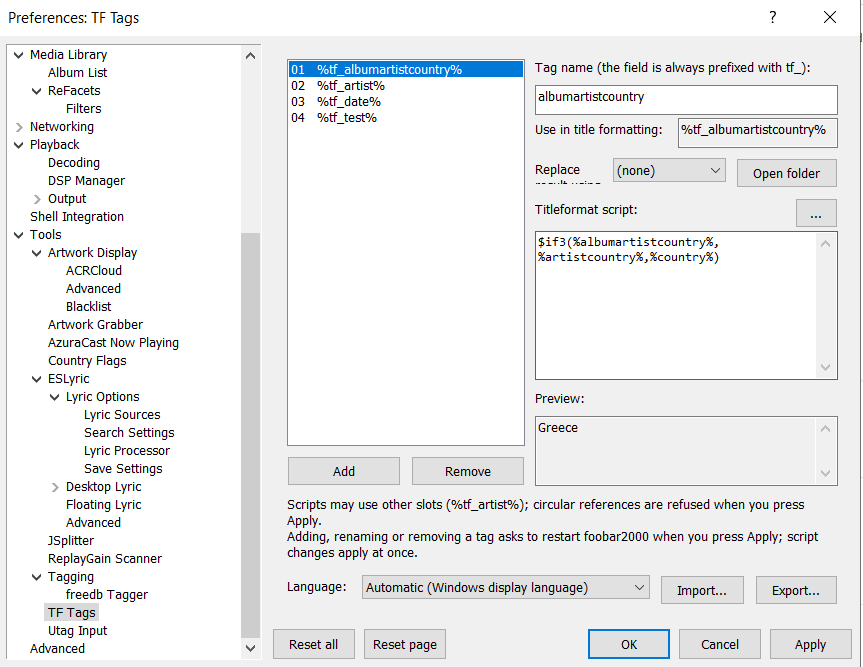

# foo_tftags

A foobar2000 component that publishes long titleformat scripts as **global tag fields**. Write a script once (for example your whole BIO_ALBUMARTIST or BIO_ARTIST code) and use `%tf_albumartist%` everywhere that evaluates title formatting: playlist views, CPV, PSS/ELP, JS3 scripts, ESlyrics, Last.fm scribbler, and so on.

## Slots

You can have **any number of slots**. Each has a **tag name** and a **titleformat script**. Open **Preferences > Tools > TF Tags**: the list on the left shows the slots, **Add** appends a new one (named `01`, `02`, ... for the first free number) and **Remove** deletes the selected slot after a confirmation. There is always at least one slot.

A new slot starts with an empty script. Slots are saved as one list, so the number is not limited; settings saved by older versions with 20 fixed slots are carried over (the slots that had a script or a table).

The field name is always `tf_` plus the tag name, so slot 1 is `%tf_albumartist%`. Tag names are lowercased and only letters, digits and `_` are kept. Empty or duplicate names get a slot number (`tf_slot4`, `tf_artist_2`). An empty script (or a script that returns nothing) makes the field empty, so `$if(%tf_artist%,...)` works.

## Writing scripts

- Scripts can span several lines. Before compiling, leading and trailing whitespace of every line is removed, `//` comments (a whole line or the end of a line; text inside 'quotes' and `://` are left alone) are removed, and the lines are joined. Do not rely on line breaks inside quoted text.
- A slot may use other slots: `%tf_artist%` inside slot 3 works. Circular references (a slot using its own field, directly or through other slots) are detected when you press **Apply**: nothing is applied and a message shows the cycle, e.g. `tf_a -> tf_b -> tf_a`. The **Preview** reports it too. As a safety net the evaluator still returns nothing for a cycle instead of looping.
- **Preview:** the box at the bottom shows the result of the script in the editor (saved or not) for the selected track, even while another track is playing: the active playlist's selection first, then the selection of another panel (e.g. the library), then the focused playlist row. Only if none of these exist does it use the playing track. It updates when you click a slot, the tag name or the script, when you move through the slot list with the arrow keys, and about 0.3 seconds after you stop typing in the script. Other slots used inside it (`%tf_artist%`) are evaluated with their saved scripts.
- **"..." button** (right of the script label) opens a larger, resizable editor for long scripts, with its own live preview that updates about 0.3 seconds after you stop typing. Tab inserts a tab character and Ctrl+A selects all. **OK** copies the text back to the script box (still not applied until you press **Apply**); **Cancel**, Esc or closing the window asks before discarding changes.
- **Apply** checks that every script compiles. If one does not, you can still apply (that slot's field is then empty) or go back and fix it. After Apply, the active playlist is refreshed so changed scripts show up.

## Replacement tables

A slot can run its result through a **replacement table**, which replaces whole names by the spelling you want. It is a JSON file in `<foobar2000 profile>\foo_tftags\tables\<name>.json` (**Open folder** next to the drop-down opens it). The key is the result you want and the value is one name or a list of names that become it:

```json
{
  "R.E.M.": ["REM", "R.E.M"],
  "T. Rex": ["T REX", "T-REX", "TYRANNOSAURUS REX"],
  "Queens of the Stone Age": []
}
```

- Matching is on the **whole value** and ignores case, like `$stricmp`. Each wanted name also matches itself, so the empty list above fixes `QUEENS OF THE STONE AGE`.
- Choose the table in the **Replace result using table** drop-down below the tag name. It is saved per slot, is part of **Export/Import**, and the **Preview** already shows the replaced value.
- **Multi-value tag fields:** when a slot has a table, the script's references to multi-value fields are replaced **value by value** before the rest of the script runs: `%artist%` with the values `Korn` and `Madonna` goes through the table as `Korn` and as `Madonna`, and the script sees `Korn, Madonna` (foobar2000's own joining). `$meta(artist, n)`, `$meta_sep(artist, sep)` and `$meta_num(artist)` use the replaced values as well. The fields are `ARTIST`, `ALBUM ARTIST`, `PRODUCER`, `COMPOSER`, `PERFORMER`, `GENRE`, `STYLE` and `COUNTRY` unless the table has a `"$fields"` entry with its own list, e.g. `"$fields": ["ARTIST", "ALBUM ARTIST"]`; every other field is left to foobar2000. A tag that is only filled in from foobar2000's fallbacks (for example `%album artist%` taken from `ARTIST`) is not touched value by value, but the final result is still run through the table.
- **Several names in one value (single-value tags):** if the whole value is not in the table, it is split at `;` and every name is replaced on its own, so `Korn;Madonna` or `Korn; Madonna` is looked up as `Korn` and `Madonna`. The original separators and spaces stay as they were (`rem;t-rex;Unknown` becomes `R.E.M.;T. Rex;Unknown`). Use a `"$split"` entry to change the separators, e.g. `"$split": [";", ", ", " / "]`, or `"$split": []` to switch splitting off. Runs of up to 6 parts are tried first, longest first, so a name that contains a separator, such as `"Earth, Wind & Fire"` with `", "` as a separator, still matches as a whole. Names that are not in the table are left alone, so splitting never damages a value. `$split` is not a name and is never used as a result. In the slot's script, `$meta_sep(artist,;)` gives every value of a multi-value tag joined with `;`.
- A name is replaced once (no chaining). Tables are re-read within about 2 seconds after the file changes, so you can edit them while foobar2000 runs. If the file is missing or not valid JSON, the field keeps its unreplaced value and the Preview says so.
- Every field that uses it, such as `%tf_artist%`, works in every component (playlist views, panels, scripts), so the table lives in one place instead of a copy in each script.


## Import and export

**Export...** (bottom right of the page) saves the tag names, scripts and tables of all slots, including changes you have not applied yet, to a UTF-8 text file (`.tftags`, one `name.NN=` and `script.NN=` line per slot, line breaks written as `\n`). **Import...** merges such a file into the page after a confirmation: a slot with the same tag name is replaced, the other slots in the file are added, slots that are not in the file are left alone, and unused slots (no script and no table) in the file are skipped. Nothing takes effect until you press **Apply** (new tags still ask to restart). The language setting is not part of the file.

## Restart and caching

- foobar2000 reads field names at startup, so **adding, renaming or removing a tag makes foobar2000 ask whether to restart when you press Apply** (answer No to restart later; the new field only takes effect after a restart, while edits to the script of an existing slot, its table, and its old name keep working at once). Script-only changes apply immediately without a restart.
- Only the compiled scripts are cached. Values are evaluated fresh on every request.


## Translations

The texts of the preferences page and its dialogs come from plain UTF-8 files in a `lang` folder next to the component DLL (inside the `.fb2k-component` archive: `lang\zh-CN.lang` beside `foo_tftags.dll`). The language is chosen from the Windows display language unless you pick one in the **Language** drop-down at the bottom of the page (it lists every `.lang` file by its `language_name`; the change applies when you press **Apply** and updates the page at once): `zh-CN.lang` (Simplified Chinese) is included, and Traditional Chinese regions (zh-TW, zh-HK, zh-MO) look for `zh-TW.lang` first, then fall back to `zh-CN.lang`. Any other language uses `<code>.lang` (e.g. `de-DE.lang`, then `de.lang`) and English when no file exists. Missing keys also fall back to English.

To add a language, copy `lang\en.lang`, rename it, set `language_name` (shown in the drop-down) and translate the text after each `=`. `\n` is a line break, `{0}` and `{1}` are placeholders, and lines starting with `#` are comments. Field names (`%tf_...%`), titleformat syntax and the component name are not translated.

## Includes

- Dynamic (stream) metadata


## Build

Visual Studio 2022, C++17, foobar2000 SDK. Link `foobar2000_SDK`, `foobar2000_component_client` and `pfc`, with the same project settings as foo_countryflags. The file must stay pure ASCII.

## License

MIT License


### Screenshot

